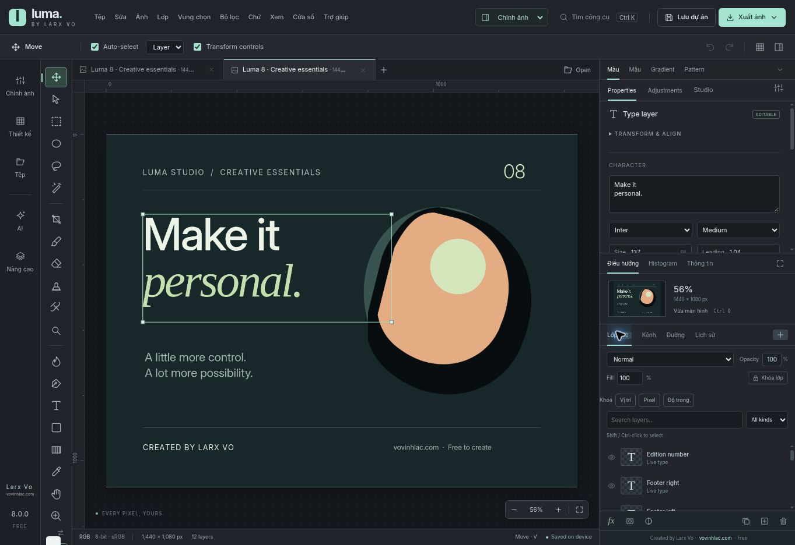
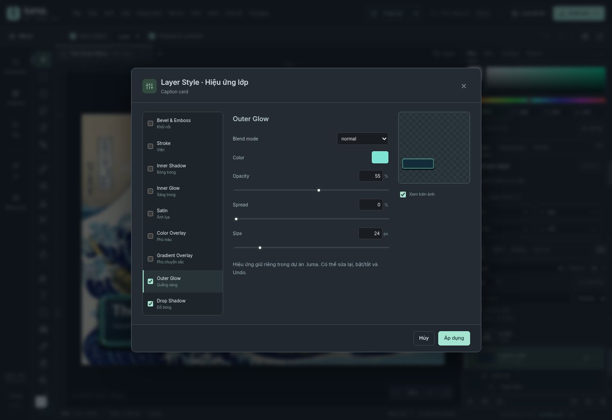

<div align="center">


# Luma Studio

### A free photo and design workspace, built around editable results.

Created by **[Larx Vo](https://vovinhlac.com)** · Windows desktop · Local image processing

[Download Windows](https://github.com/larxvo/lumia-studio/releases/latest) · [Tiếng Việt](README.vi.md) · [Documentation](docs/INSTALLATION.md)


</div>



Luma Studio brings layered editing, portrait retouch, subject selection, local inpainting, studio presets and design tools into one workspace. Start with an automatic result, inspect it, then refine the mask or parameters. Keep the original source and save an editable `.luma` project before exporting the finished image.

The editor is free to use, with no Luma subscription or forced watermark. Core editing and bundled ONNX inference run on the user's machine. External generative AI, Canva and collaboration connections are optional and have their own configuration, hardware or account requirements.

> **Current scope:** an actively developed editor with explicit compatibility boundaries. Luma does not implement every Photoshop feature, does not edit an entire native Canva layer tree offline, and does not claim a physical-GPU image-quality certification. Read [compatibility](docs/COMPATIBILITY.md) and the release reports before depending on a particular workflow.

## Download and start

Download the Windows x64 setup from [Releases](https://github.com/larxvo/lumia-studio/releases). Each release includes the installer, SHA-256 checksum, source archive and available verification reports. The installer bundles the editor/runtime; normal photo editing does not require a separate Node.js or Python installation.

1. Install for your Windows account and open an image or an RGB/8-bit PSD.
2. Choose a task under **Chỉnh ảnh**, or use **Ctrl+K** to find a tool.
3. Apply a preset, review the result at 100% and adjust its controls.
4. Use **Ctrl+Z / Ctrl+Shift+Z**, save `.luma`, then export a separate image.

Installers are currently **unsigned**. Archive/payload verification and Windows CI smoke checks are reported separately from interactive testing and GPU validation. See [installation and troubleshooting](docs/INSTALLATION.md).

## What you can work on

| Workspace | Implemented tools |
| --- | --- |
| **Portrait** | Editable auto portrait, skin-region retouch, shine reduction, facial adjustments, eyebrow/stubble controls, red-eye correction, hair/iris recolor and expression tools. |
| **Select and remove** | Subject/object prompts, portrait/hair matting, mask brushes and source restoration, keep/remove controls, local LaMa reconstruction and protected-region compositing. |
| **Color and light** | Landscape HDR-style tone mapping, studio presets, garment/product recolor, beverage cleanup, background composition, bokeh, lighting and editable shadows. |
| **Restore and documents** | Fading/scratch cleanup, reference-assisted repair, optional AI colorization, paper shading/crease reduction and enhancement of existing text/red ink. |
| **Art and design** | Text/shapes, vector/path editing, halftone/cross/pixel patterns, supported SVG geometry, raster art presets and optional generative 3D-style illustration. |
| **Layers and production** | Groups, masks, alpha channels, paths, Smart Objects, supported live filters, contextual inspectors, history, presets/actions and ICC-based print output. |

Automatic selection can need correction around hair, fingers, transparent materials and overlapping people. Inpainting creates plausible content rather than proving what was originally hidden. Studio/art effects and neural inference are distinguished in the detailed guides.


## Application screenshots

Captured in Luma Studio. Screenshots document the displayed build; they are not generated interface mockups.



## Formats and integrations

| Area | Supported path | Important boundary |
| --- | --- | --- |
| **PSD / PSB** | RGB 8-bit layers, supported type/adjustments, masks, alpha, paths and embedded Smart Objects | Unsupported complex structures can use the saved composite; not full Photoshop parity. |
| **Smart Filters** | Gaussian Blur, Unsharp Mask, High Pass and Invert in the supported subset | Separate filter masks/blends and arbitrary warps are not implemented. |
| **Print** | Native-size PNG/JPEG with DPI metadata; flattened CMYK TIFF through an ICC profile | Editing remains RGB 8-bit; use the printer's ICC profile. |
| **Canva** | Desktop OAuth connector, design search, native-editor handoff, PNG page import and edited-image upload | Requires a configured developer app. Native editing occurs in Canva; imported PNG pages are flattened. |
| **PPTX / SVG** | Editable supported text/images/shapes as interchange | Advanced layout/effects are limited; import reports explain losses. |
| **Generative AI** | Optional connection to a user-supplied ComfyUI endpoint | Checkpoints, GPU/server costs, permissions and output quality belong to that deployment. |

Normal image import has no fixed compressed-file MB cutoff. Actual RAM/canvas capacity, format constraints and individual inference/tool limits still apply. There is no promise of unlimited pixels or universal automatic quality.

## Run from source

Node.js 24 LTS and npm are recommended. The repository includes the local model/runtime assets and their notices.

```bash
git clone https://github.com/larxvo/lumia-studio.git
cd lumia-studio
npm ci
npm run build
npm run dev
```

Open the URL printed by the server. `dist/` contains maintained editor source: **do not delete it as disposable build output**. For Windows development, run `npm run desktop:dev`; package with `npm run desktop:win`.

```bash
node --test --test-concurrency=1 tests/*.test.mjs
python -m pip install numpy==2.3.5 Pillow==13.0.0
python -m unittest tests/gpu_kit_test.py
```

See [development and release instructions](docs/DEVELOPMENT.md) for generation order, packaging and verification.

## Documentation

| Guide | Purpose |
| --- | --- |
| [Vietnamese introduction](README.vi.md) | Product overview and common workflows in Vietnamese. |
| [Installation](docs/INSTALLATION.md) | Windows, browser, first edit and troubleshooting. |
| [Compatibility](docs/COMPATIBILITY.md) | Formats, supported subsets and known limitations. |
| [Architecture](docs/ARCHITECTURE.md) | Document/rendering/worker/desktop boundaries and data flow. |
| [Development](docs/DEVELOPMENT.md) | Local setup, checks, source packaging and CI/release process. |
| [Canva](docs/CANVA.md) | OAuth configuration, actual handoff behavior and public-integration requirements. |
| [GPU verification](docs/GPU-VERIFICATION.md) | CUDA proof, benchmark artifacts and remaining quality evaluation. |
| [Roadmap](ROADMAP.md) | Prioritized work and the evidence required to call it complete. |
| [Changelog](CHANGELOG.md) | Current changes and preserved earlier release history. |
| [Versioned feature guides](FEATURES.vi.md) | Existing detailed editor guides; check their version scope. |

## Quality, privacy and contribution

The repository contains pixel/format round trips, inference checks, DOM interaction tests, malformed-input/security checks and versioned visual evidence. The 9.0 baseline recorded 407 JavaScript tests passing; subsequent targeted checks are retained under `qa/`. Current CI is the authoritative status for the current commit. A mocked OAuth test is not a live Canva validation, and a CPU/WASM or Windows packaging test is not a physical-GPU quality result.

Core editing uses local files/storage. Optional connected workflows send the selected content to the endpoint/service you configure. Keep original files, review masks and use non-sensitive fixtures when reporting problems. Skin tools are cosmetic/research tooling, not a clinical diagnostic system.

Please read [CONTRIBUTING.md](CONTRIBUTING.md) before submitting a change and [SECURITY.md](SECURITY.md) before reporting a vulnerability. Bug/feature issue forms and a pull-request template are included.

## License and author

Application code: [MIT](LICENSE). Bundled components, weights, profiles, fonts and sample assets retain their upstream licenses; see [third-party notices](THIRD_PARTY_NOTICES.md). Optional checkpoints/research weights are not bundled or relicensed.

**Luma Studio is created by Larx Vo · [vovinhlac.com](https://vovinhlac.com).** Attribution belongs in the application and documentation; Luma does not force a visual watermark onto the user's exported work.

The GitHub repository slug is `lumia-studio`; the product name is **Luma Studio**. Adobe, Photoshop, Lightroom and Canva are names of their respective owners; this is an independent project.
