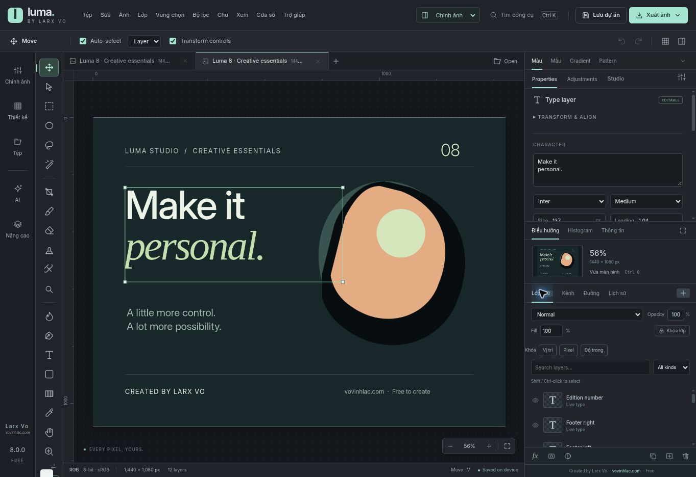

# Luma Studio

Phần mềm chỉnh ảnh và thiết kế miễn phí, được tạo bởi **[Larx Vo · vovinhlac.com](https://vovinhlac.com)**.

[Tải bản Windows](https://github.com/larxvo/lumia-studio/releases/latest) · [English](README.md)

Luma hướng tới quy trình **chọn công việc → có kết quả tự động → chỉnh thêm bằng mask và thanh điều chỉnh → lưu dự án → xuất ảnh**. Bạn giữ ảnh gốc và có thể quay lại chỉnh các thiết lập được hỗ trợ. Không có thuê bao Luma hoặc watermark bắt buộc.



## Những nhóm công cụ chính

- **Chân dung:** auto chỉnh nhẹ đường nét mặt/cằm, bóng dầu, chân mày, da, mắt đỏ, màu tóc/mắt và biểu cảm; có tham số để điều chỉnh tiếp.
- **Tách và xóa:** chọn chủ thể/vật thể, tách nền/tóc, sửa mask, lấy lại pixel nguồn, chọn người giữ lại và xóa phần còn lại; local LaMa hỗ trợ tái dựng.
- **Màu và ánh sáng:** HDR-look phong cảnh, màu trang phục/sản phẩm, đồ uống, hậu cảnh, bokeh, ánh sáng và bóng.
- **Phục hồi và giấy tờ:** giảm bạc màu/xước/ố, vá từ tham chiếu, tô màu AI tùy chọn, làm đều nền giấy và tăng độ rõ nét chữ/mực dấu hiện có.
- **Thiết kế:** chữ, shape, đường vector, layer/group/mask, kênh alpha, Smart Objects, pattern/halftone, art và ảnh minh họa kiểu 3D.
- **Xuất ảnh:** PNG/JPEG giữ kích thước nguồn theo khả năng máy, DPI tùy chỉnh, TIFF CMYK có ICC; lưu `.luma` để giữ thiết lập Luma.

Công cụ tự động vẫn có thể cần sửa viền tóc, ngón tay, vật liệu trong suốt và vùng che khuất. AI không thể xác nhận chi tiết đã mất là đúng lịch sử nếu không có tư liệu tham chiếu. Không hứa làm rõ chính xác mọi chữ/con dấu đã mất dữ liệu.

## Cài và sử dụng

1. Tải file `Luma-Studio-<version>-Setup-x64.exe` tại Releases, đối chiếu SHA-256 đi kèm.
2. Cài cho tài khoản Windows hiện tại; không cần cài riêng Node/Python để chỉnh ảnh thông thường.
3. Mở ảnh hoặc PSD RGB 8-bit. Dùng **Chỉnh ảnh / Thiết kế / Nâng cao**, hoặc **Ctrl+K** để tìm công cụ.
4. Chọn preset, xem trước ở 100%, chỉnh mask/thanh điều chỉnh, dùng **Ctrl+Z** để hoàn tác.
5. Lưu `.luma` rồi xuất một bản ảnh riêng.

Bộ cài hiện **chưa ký số**. Kết quả kiểm tra dữ liệu đóng gói, cài/gỡ trên runner Windows và kiểm thử giao diện/GPU được báo cáo riêng. Xem [hướng dẫn cài đặt](docs/INSTALLATION.md) và báo cáo của từng release.

## Phạm vi tương thích

| Hạng mục | Trạng thái |
| --- | --- |
| PSD/PSB | Có biên tập RGB 8-bit trong tập tính năng hỗ trợ; file phức tạp có thể mở composite. Chưa thay thế toàn bộ Photoshop. |
| Smart Filters | Gaussian Blur, Unsharp Mask, High Pass, Invert theo điều kiện tương thích. |
| Canva | Đã có connector OAuth, mở bản gốc trong Canva, lấy trang PNG về Luma và gửi ảnh sang thiết kế Canva mới. Cần app Developer; chưa sửa toàn bộ layer Canva offline. |
| Generative AI | Cần máy ComfyUI, model và phần cứng của bạn. |
| GPU thật | Có probe/benchmark; chưa có chứng nhận chất lượng ảnh tổng quát từ GPU vật lý. |
| Màu in | Chuyển/xem thử qua ICC và xuất TIFF CMYK; engine biên tập vẫn RGB 8-bit. |
| Ảnh lớn | Không chặn theo một mức MB cố định ở luồng nhập ảnh thường; vẫn phụ thuộc RAM/canvas, định dạng và giới hạn từng công cụ. |
| Art/3D | Có hiệu ứng và ảnh minh họa 2D kiểu 3D; chưa dựng mesh 3D hoàn chỉnh. |

Xem [bảng tương thích đầy đủ](docs/COMPATIBILITY.md), [Canva](docs/CANVA.md), [GPU](docs/GPU-VERIFICATION.md) và các tài liệu `*.vi.md` theo phiên bản. Công cụ da dùng cho retouch/nghiên cứu, không phải chẩn đoán bệnh.

## Phát triển từ mã nguồn

```bash
git clone https://github.com/larxvo/lumia-studio.git
cd lumia-studio
npm ci
npm run build
npm run dev
```

Khuyến nghị Node.js 24 LTS. `dist/` chứa mã editor được duy trì; không xóa như thư mục build tạm. Đọc [kiến trúc](docs/ARCHITECTURE.md), [development](docs/DEVELOPMENT.md), [đóng góp](CONTRIBUTING.md), [bảo mật](SECURITY.md) và [lịch sử thay đổi](CHANGELOG.md).

Mã ứng dụng dùng [MIT](LICENSE); model, thư viện, font và ảnh mẫu giữ giấy phép riêng trong [THIRD_PARTY_NOTICES.md](THIRD_PARTY_NOTICES.md). Thông tin **Larx Vo · vovinhlac.com** hiển thị trong ứng dụng; không đóng dấu bắt buộc lên ảnh của bạn.
