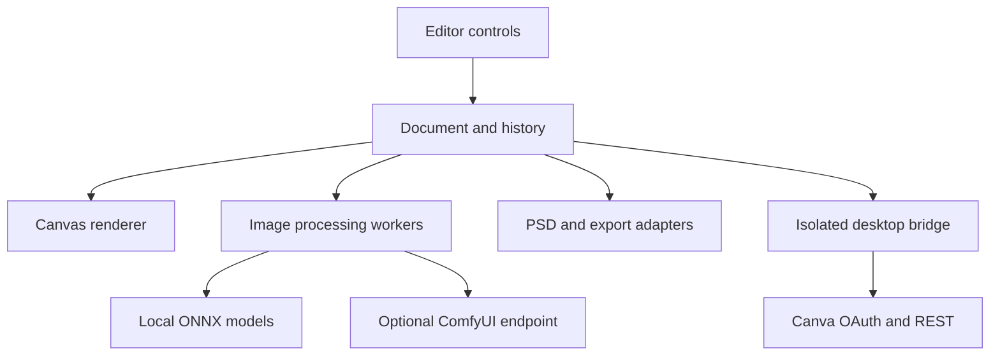

# Architecture

Luma Studio separates the document model, interactive editor, compute workers and optional external services. The browser application and Windows application share the same editing engine.

## Modules

| Location | Responsibility |
| --- | --- |
| `dist/app.js` | Editor orchestration, commands, file operations and sessions. |
| `dist/model.js`, `dist/storage.js` | Serializable document state, validation, history and local persistence. |
| `dist/renderer.js`, `dist/layer-*.js` | Canvas compositing, effects, masks and edit permissions. |
| `dist/*-ui.js`, `dist/workspace-navigation.js` | Task workspaces, contextual inspectors and command search. |
| `dist/*-worker.js`, `dist/*-inference.js` | Cancellable processing and local inference. |
| `dist/ai/` | Versioned model chunks, hashes, preprocessing manifests and upstream notices. |
| `src/psd*.js` | PSD/PSB translation, typography, native channels, paths and supported Smart Filters. |
| `desktop/app/` | Electron main process, restricted preload and Canva client. |
| `gpu-kit/` | Optional local Python service, CUDA proof and reconstruction benchmark. |
| `tests/` | Document, pixel, inference, adapter, security and DOM integration checks. |
| `scripts/` | Build, packaging, integrity checks, relay and source distribution. |

`dist/` contains the maintained editor modules, not just disposable generated output. `npm run build` regenerates the bundled PSD/ZIP bridges and copies third-party runtime files into `dist/vendor/`. Do not delete `dist/` before building.

## Document and edit lifecycle

A document stores ordered layers, supported adjustments, masks, paths, alpha channels, embedded Smart Objects and source-preserving recipes. A preview may use reduced dimensions; source pixels and document dimensions are retained for supported export paths. Tool-specific inference and format limits still apply.

An operation validates its target and layer permissions, creates a preview or temporary result, then commits a document snapshot. Cancel restores the previous state; undo/redo operates on committed history. Worker requests use cancellation and stale-result guards in their respective workflows. A generated image is stored as a result, with processing provenance where supported.

`.luma` is the native project representation. PSD is an interchange format with an explicit compatibility boundary; unsupported structures can fall back to the saved Photoshop composite. Such a fallback does not preserve every source layer as editable content.

## Desktop boundary

The renderer has `nodeIntegration: false`, `contextIsolation: true` and sandboxing enabled. A custom `luma://app` origin serves bundled assets. Main-process IPC checks the sender and exposes a small operation allowlist through `preload.cjs`. External HTTPS links open in the system browser; webviews and general renderer permissions are denied.

Canva authentication and API calls live in the main process. The renderer receives design summaries or exported bytes, never access tokens. A local callback server accepts the registered loopback path and validates one-use, expiring PKCE state. The client secret remains in process memory; tokens use the operating-system credential protection when available.

## Optional services

ComfyUI is supplied and configured by the user. Its model selection, VRAM, latency and quality are separate from the bundled CPU/WASM tools. Collaboration uses the included session/relay tools and a user-selected connection; it is not a managed, always-on hosted collaboration service.

The Python CUDA proof checks a real tensor operation. The reconstruction benchmark checks completed jobs against a known image and writes review artifacts. Neither a device name nor a successful compute operation establishes general image quality.
