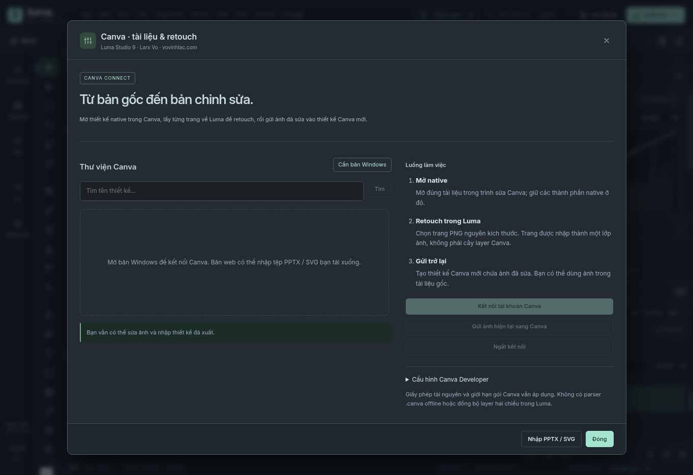

# Canva Connect

The connector is implemented in `desktop/app/canva.cjs` and exposed through the isolated desktop preload. It uses Canva's official REST APIs, not a reverse-engineered native document format.

## Configure a developer app

Register `http://127.0.0.1:47831/canva/callback` as the redirect URL and enable these scopes:

```text
design:meta:read design:content:read design:content:write asset:read asset:write
```

In Windows, open **Tệp → Canva · mở native & retouch → Cấu hình Canva Developer**. Enter your own Client ID and Client secret locally. Do not send secrets through a GitHub issue, screenshot or chat. The secret is not bundled and remains in the main-process memory for the session. Tokens use OS-backed encryption when available.

Authorize in the system browser. Luma verifies random expiring state and the PKCE SHA-256 exchange. A failed callback is not accepted as a successful login. Token refresh is serialized to protect refresh-token rotation.

## What the workflow does

| Action | Result |
| --- | --- |
| Search designs | Lists authorized designs with pagination. |
| Open native | Obtains a fresh Canva edit URL and opens the original in Canva's official editor. |
| Import page | Downloads a lossless PNG page into one Luma image layer, retaining design ID/page provenance. |
| Send image | Uploads the actual edited PNG and creates a separate Canva design containing that image. |
| Disconnect | Clears local tokens and requests revocation; if the network is unavailable, review/revoke the grant in Canva. |

Native elements stay in Canva. PNG import is flattened. Full offline Canva editing, arbitrary native layer-tree import and two-way layer synchronization are not implemented. Premium assets, account permissions and Canva export limits still apply.

A shared public integration needs its own approved Canva app and a backend that protects the application secret. Requiring each user to enter a developer secret is a development/personal-app setup, not the final public onboarding experience. Live account verification is still pending; automated connector tests use labeled HTTP fixtures.

Official references: [authentication](https://www.canva.dev/docs/apps/rest-apis/authentication/), [design listing](https://www.canva.dev/docs/apps/rest-apis/reference/designs/list-designs/), [exports](https://www.canva.dev/docs/apps/rest-apis/reference/exports/create-design-export-job/).



